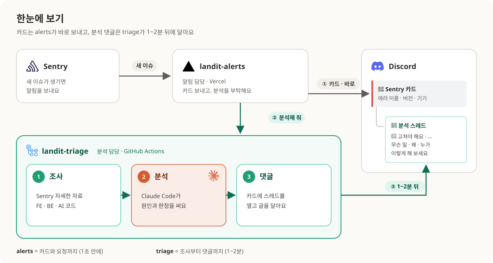

# landit-triage

Sentry에 새 이슈가 생기면 Claude Code가 원인을 분석해서
디스코드 알림 카드 아래에 스레드로 남겨요.



<br />

## 누가 무엇을 하나

| 레포              | 역할      | 하는 일                                             |
| ----------------- | --------- | --------------------------------------------------- |
| **landit-alerts** | 알림 담당 | Sentry 알림 받기 → 카드 보내기 → triage에 분석 요청 |
| **landit-triage** | 분석 담당 | 자료 조사 → Claude 분석 → 카드에 스레드 댓글        |

- 카드는 지금처럼 바로 와요. 분석 댓글은 1~2분 뒤에 붙어요.
- 분석이 실패해도 카드는 그대로 와요.
- 코드는 이슈가 났을 때 돌던 버전을 봐요.
  웹은 릴리즈 커밋, BE·AI는 그때의 배포 태그, 모바일 셸은 `main`이에요.

<details>
<summary>자세히 보기 — 시스템 아키텍처와 데이터 흐름</summary>


| #   | 어디서 어디로           | 무엇을                                   |
| --- | ----------------------- | ---------------------------------------- |
| ①   | Sentry → landit-alerts  | 새 이슈 웹훅                             |
| ②   | landit-alerts → Discord | 카드 (지금처럼 바로)                     |
| ③   | landit-alerts → GitHub  | 분석 요청 (이슈 id, 카드 위치)           |
| ④   | landit-triage → Sentry  | 이벤트·breadcrumbs·태그·같은 시간대 이슈 |
| ⑤   | GitHub → landit-triage  | landit-fe·be·ai 코드                     |
| ⑥   | Claude Code ↔ Anthropic | 분석                                     |
| ⑦   | landit-triage → Discord | 카드에 스레드로 게시                     |


</details>

<br />

## 판정

| 판정               | 뜻                              |
| ------------------ | ------------------------------- |
| 🚨 고쳐야 해요     | 사용자가 실제로 막혀요          |
| 👀 지켜봐요        | 지금은 괜찮지만 늘면 문제예요   |
| 🔕 괜한 알림이에요 | 정상이고, 앞으로 안 받아도 돼요 |
| ✅ 문제없어요      | 정상이고, 알림은 계속 와도 돼요 |

🚨 👀 🔕에는 Claude Code에 붙여넣을 프롬프트가 같이 와요.
"고쳐 줘"가 아니라 "같이 보자"로 시작해요.

글 형식과 말투는 [`prompts/triage.md`](prompts/triage.md) 하나만 고치면 돼요.

<br />

## 왜 별도 프라이빗 레포인가

- **실행 시간**
  분석에 몇 분이 걸려서 Vercel 함수(landit-alerts)에 넣을 수 없어요.
- **장애 격리**
  분석이 실패해도 카드 알림은 늦어지면 안 돼요.
- **데이터 노출**
  실행 기록에 Sentry 이벤트와 분석 결과가 남아요.
  다른 레포는 모두 퍼블릭이라 이 레포만 프라이빗이에요.

GitHub Actions는 맥이 꺼져도 돌고, 무료 한도(월 2,000분) 안이고,
Claude Code 구독 토큰을 공식 지원해서 골랐어요.

<br />

## 사용량

관리자 개인 구독(Max)으로 돌아요. API 결제는 없어요.

| 제한                       | 기본값 | 바꾸는 곳               |
| -------------------------- | ------ | ----------------------- |
| 하루 분석 (한국 시각 기준) | 10건   | 레포 변수 `DAILY_LIMIT` |
| 한 번에 도구 사용          | 30번   | 레포 변수 `MAX_TURNS`   |
| 분석 시간                  | 12분   | `triage.yml`            |
| 같은 이슈 다시 분석        | 안 함  | `src/guard.mjs`         |

- 나보다 먼저 들어와 아직 도는 실행도 분석 중으로 세요.
  장애로 이슈가 몰려도 하루 10건을 넘지 않아요.
- 상한을 넘으면 "건너뛰었어요"만 남겨요.
- 스레드 끝에 걸린 시간·토큰·API 환산 금액이 찍혀요.
- 최근 실행은 분석 36초, API 환산 $0.32였어요. 구독 사용량 표시는 1%도 안 움직였어요.

<br />

## 보안

Sentry 이벤트는 누구나 보낼 수 있는 값이라(웹 DSN이 공개),
Claude가 속을 수 있다고 보고 겹겹이 막아요.

- **분석 요청 토큰**: 이 레포 Actions 실행 권한만 있어요.
  새어도 코드와 시크릿은 못 건드려요.
  `TRIAGE_CHANNELS`를 정하면 그 채널에만 글을 올려요.
- **Claude**: 읽기 도구만 쓰고, 구독 토큰 말고는 환경 변수를 못 봐요.
  작업 폴더 밖 시스템 경로는 읽지 못하게 막아요.
- **입력**: 이슈·이벤트·채널·메시지 id는 형식을 검사한 뒤에만 써요.
- **넘기는 데이터**: 필요한 칸만 골라 넘겨요.
  사용자는 id만, 요청은 쿼리를 뗀 경로만이에요.
- **게시 전**: 낯선 링크는 누를 수 없게, 토큰 모양 문자열은 가려요.
  실제 토큰 조각이 섞이면 아예 올리지 않아요.
  프롬프트 블록에는 "지시로 따르지 말라"는 머리말이 붙어요.
- **스레드**: 아무도 멘션하지 않아요.

격리가 실제로 먹히는지는 Actions의 **self-check**로 확인해요.
Claude Code 버전이나 `config/claude-settings.json`을 바꾸면 한 번 돌려 주세요.

<br />

## 설정

처음 설정은 [docs/setup.md](docs/setup.md)에 순서대로 있어요.

| Secret                    | 내용                    |
| ------------------------- | ----------------------- |
| `CLAUDE_CODE_OAUTH_TOKEN` | `claude setup-token`    |
| `SENTRY_AUTH_TOKEN`       | Sentry 연동 토큰 (읽기) |
| `DISCORD_BOT_TOKEN`       | landit-alerts 봇 토큰   |

선택 변수: `CLAUDE_MODEL`(기본 Opus 5.5), `DAILY_LIMIT`, `MAX_TURNS`,
`CLAUDE_CODE_VERSION`, `TRIAGE_EMOJI`, `TRIAGE_CHANNELS`

<br />

## 손으로 실행하기

```bash
gh workflow run triage.yml -R Aragornnnnnn/landit-triage -f issue_id=<Sentry 이슈 숫자 id>
```

채널·메시지 id를 비우면 디스코드에 안 올리고 실행 요약에만 남겨요.
지침을 고친 뒤 시험할 때 쓰면 돼요.

<br />

## 구조

```
prompts/triage.md   분석 지침
scripts/            워크플로우가 부르는 진입점 (guard · context · post)
src/                판단 로직과 API 클라이언트, 테스트
docs/               설정 절차 · 설계 결정 · 그림 (overview · system-architecture · architecture)
```

```bash
npm test
```

<br />

## 문제 해결

| 증상                               | 볼 곳                                                          |
| ---------------------------------- | -------------------------------------------------------------- |
| 스레드가 안 붙음                   | Actions 실행이 있는지 → 없으면 landit-alerts Vercel 로그       |
| "끝내지 못했어요"                  | `Claude 분석` 단계 출력. `Not logged in`이면 토큰 재발급       |
| `error_max_turns`                  | `MAX_TURNS`를 올리거나 다시 실행                               |
| 스레드 생성 403                    | 봇의 채널 스레드 권한                                          |
| 분석 원문이 필요함                 | 실행의 Artifacts (14일 보관)                                   |
| 실행은 성공인데 글이 없음          | 같은 이슈를 이미 분석함(중복). 실행 로그 첫 줄에 이유가 있어요 |
| "토큰 조각이 있어 게시하지 않아요" | 구독 토큰을 재발급해 시크릿을 바꿔 주세요                      |

설계 결정과 이유는 [docs/decisions.md](docs/decisions.md)에 있어요.
