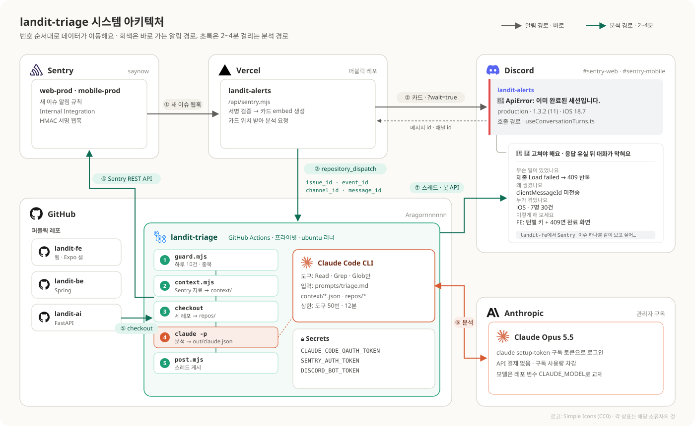
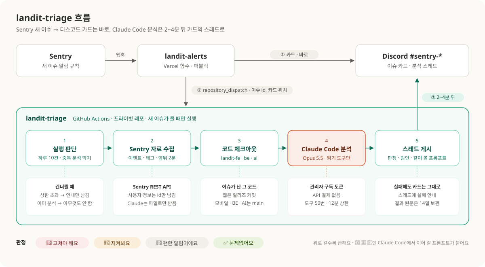
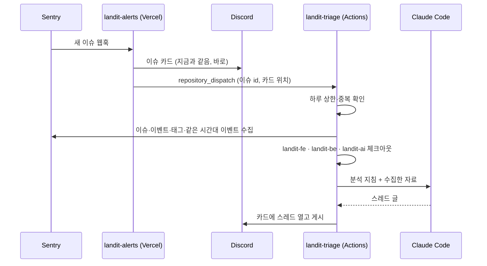

# landit-triage

Sentry에 새 이슈가 생기면 Claude Code가 FE·BE·AI 코드를 함께 읽고 원인을 분석해, 디스코드 알림 카드 아래 스레드로 남깁니다.

```
🚨 고쳐야 해요 · 응답 유실 뒤 완료된 시나리오에 계속 제출해 막혀요
 ├ 무슨 일이 있었나요   breadcrumbs로 본 흐름
 ├ 왜 생겼나요          원인 + FE·BE·AI 코드 링크
 ├ 누가 겪었나요        플랫폼 · 버전 · 사용자 수 · 추이
 ├ 이렇게 해 보세요      FE·BE·AI 중 고칠 곳, 나은 곳 먼저
 ├ 근거                 같은 사건 · 확실한 것과 추정
 └ Claude Code에서 이어 갈 프롬프트
```

## 목차

- [시스템 아키텍처](#시스템-아키텍처)
- [동작 방식](#동작-방식)
- [판정 네 단계](#판정-네-단계)
- [왜 별도 프라이빗 레포인가](#왜-별도-프라이빗-레포인가)
- [사용량 제한](#사용량-제한)
- [보안](#보안)
- [레포 구조](#레포-구조)
- [설정](#설정)
- [손으로 실행하기](#손으로-실행하기)
- [개발](#개발)
- [문제 해결](#문제-해결)

## 시스템 아키텍처



| #   | 출발 → 도착             | 오가는 데이터                                                                             | 인증                                                        |
| --- | ----------------------- | ----------------------------------------------------------------------------------------- | ----------------------------------------------------------- |
| ①   | Sentry → landit-alerts  | 새 이슈 `event_alert` 웹훅 (이벤트 전체)                                                  | HMAC 서명 (`SENTRY_CLIENT_SECRET`)                          |
| ②   | landit-alerts ↔ Discord | 이슈 카드 embed를 보내고, 올라간 메시지 id·채널 id를 돌려받음 (`?wait=true`)              | 채널 웹훅 URL                                               |
| ③   | landit-alerts → GitHub  | `repository_dispatch` — `issue_id`, `event_id`, `channel_id`, `message_id`                | `TRIAGE_DISPATCH_TOKEN` (landit-triage 하나, Contents 쓰기) |
| ④   | landit-triage → Sentry  | 이슈 상세, 알림 이벤트, 최근 이벤트 5건, 태그 분포, 앞뒤 2분 다른 이슈 → `context/*.json` | `SENTRY_AUTH_TOKEN` (읽기)                                  |
| ⑤   | GitHub → landit-triage  | landit-fe(웹은 릴리즈 커밋), landit-be, landit-ai 코드 → `repos/`                         | 없음 (퍼블릭)                                               |
| ⑥   | Claude Code ↔ Anthropic | 분석 지침 + `context/` + 읽은 코드 조각, 응답으로 스레드 글                               | `CLAUDE_CODE_OAUTH_TOKEN` (구독)                            |
| ⑦   | landit-triage → Discord | 카드 메시지에 스레드 생성, 분석 글 게시                                                   | `DISCORD_BOT_TOKEN`                                         |

경로는 두 갈래예요. ①②는 지금까지와 같은 **알림 경로**라 바로 끝나고, ③부터 ⑦까지는 **분석 경로**라 2~4분 걸려요. 분석 경로가 어디서 실패해도 알림 경로는 영향을 받지 않아요.

## 동작 방식



<details>
<summary>시간 순서로 보기</summary>



</details>

1. **카드는 지금처럼 바로 와요.** 분석은 그 뒤 2~4분 안에 스레드로 붙어요. 분석이 실패해도 카드 알림은 영향이 없어요.
2. **Claude는 Sentry에 직접 접근하지 않아요.** `scripts/context.mjs`가 필요한 자료를 미리 파일로 모으고, Claude는 그 파일과 세 레포 코드만 읽어요.
3. **코드는 이슈가 난 그 버전을 봐요.** 웹 이슈는 Sentry 릴리즈(=landit-fe 커밋)로 체크아웃하고, 모바일·BE·AI는 배포 기준인 `main`을 봐요.
4. **같은 사건을 묶어요.** 한 사건이 메시지가 다른 여러 이슈로 갈라져 올라오는 일이 많아서, 앞뒤 2분 안의 다른 이슈를 같은 사건 후보로 함께 넘겨요.

분석 지침 전문은 [`prompts/triage.md`](prompts/triage.md)에 있어요. 글의 형식과 말투를 바꾸려면 이 파일만 고치면 돼요.

## 판정 네 단계

위로 갈수록 급해요.

| 판정               | 뜻                                     | 마지막 칸                    | 프롬프트 |
| ------------------ | -------------------------------------- | ---------------------------- | -------- |
| 🚨 고쳐야 해요     | 사용자가 실제로 막혀요                 | 이렇게 해 보세요             | ✓        |
| 👀 지켜봐요        | 지금은 괜찮지만 조건이 바뀌면 문제예요 | 다시 볼 때 (숫자 조건)       | ✓        |
| 🔕 괜한 알림이에요 | 동작은 맞고, 앞으로는 안 받아도 돼요   | 이렇게 해 보세요 (보고 빼기) | ✓        |
| ✅ 문제없어요      | 정상이고, 알림은 계속 와도 돼요        | 다시 볼 때 (숫자 조건)       |          |

🔕와 ✅의 차이는 **이 알림이 앞으로도 와야 하느냐**예요. 로그아웃하며 끊긴 요청처럼 받아도 알 게 없는 알림은 🔕, 세션 만료처럼 하나하나는 정상이지만 갑자기 늘면 서버 문제의 신호가 되는 알림은 ✅예요.

프롬프트는 "이렇게 고쳐 줘"가 아니라 "같이 보자"로 시작해요. 받는 Claude Code가 Sentry 링크와 코드를 직접 다시 확인하고, 방향을 제안한 뒤 고르면 테스트부터 쓰게 돼 있어요. 자동 분석이 틀렸을 때 그대로 코드가 되지 않게 하려는 장치예요.

## 왜 별도 프라이빗 레포인가

**landit-alerts에 넣지 않은 이유**

- landit-alerts는 Vercel 함수와 짧은 크론으로 도는 알림 전송 레포예요. 분석은 2~4분 동안 세 레포를 체크아웃하고 Claude Code를 실행해야 해서, 서버리스 함수의 실행 시간 안에 들어가지 않아요. 새 Vercel 서버도 띄울 수 없어요.
- 알림 전송과 분석은 실패하는 방식이 달라요. 분석이 실패하거나 느려져도 카드 알림은 절대 늦어지면 안 돼서, 둘을 다른 실행 환경으로 떼어 놨어요.

**프라이빗이어야 하는 이유**

- landit-fe·landit-be·landit-ai·landit-alerts는 모두 퍼블릭 레포예요. 퍼블릭 레포의 Actions 실행 기록은 누구나 볼 수 있어요.
- 이 레포의 실행 기록과 보관 파일에는 Sentry 이벤트(스택, breadcrumbs, 요청 경로, 사용자 id)와 분석 결과가 남아요. 밖에 보여서는 안 되는 데이터라 실행 자체를 프라이빗 레포에서 해요.
- 코드를 읽는 쪽은 퍼블릭 레포라 체크아웃에 별도 토큰이 필요 없어요.

**GitHub Actions를 고른 이유**

- 실행마다 깨끗한 서버를 잠깐 빌리고 끝나면 사라져요. 맥이 꺼져 있어도 돌아가요.
- 프라이빗 레포 무료 한도(월 2,000분) 안에서 충분히 돌아요. 이슈 하나에 몇 분이에요.
- 실행 기록, 실패 로그, 손으로 다시 돌리기가 기본으로 있어요.
- Claude Code가 구독 토큰(`claude setup-token`)으로 CI에서 도는 방식을 공식 지원해요. API 결제가 따로 생기지 않아요.

## 사용량 제한

Claude Code는 관리자 개인 구독으로 돌아요. 구독 사용량 %는 자동화 안에서 읽을 수 없어서, 우리가 정한 숫자로 막아요.

| 장치                                 | 기본값                                 | 바꾸는 곳               |
| ------------------------------------ | -------------------------------------- | ----------------------- |
| 하루 분석 상한 (한국 시각 자정 기준) | 10건                                   | 레포 변수 `DAILY_LIMIT` |
| 한 번에 Claude가 도구를 쓰는 횟수    | 50번                                   | 레포 변수 `MAX_TURNS`   |
| 분석 단계 실행 시간                  | 12분                                   | `triage.yml`            |
| 같은 이슈 다시 분석                  | 안 함 (지난 분석이 실패했으면 다시 함) | `scripts/guard.mjs`     |

상한을 넘으면 Claude를 부르지 않고 스레드에 "오늘 분석 한도를 넘어서 건너뛰었어요"만 남겨요. 분석마다 걸린 시간과 토큰 수가 스레드 끝(`-# 분석 2분 31초 · 토큰 15.2만`)과 실행 요약에 남아요. 처음 며칠은 분석 전후로 claude.ai 사용량 화면을 비교해 "토큰 n만 ≈ 몇 %"를 재 두면, 그다음부터는 토큰 수만 보고 어림할 수 있어요.

참고로 테스트에서는 이슈 하나에 토큰 12만에서 18만 개, 시간은 2~4분이 들었어요(Opus 5.5 기준). 최근 30일 새 이슈는 하루 1건이 안 돼서, 평소에는 상한에 닿지 않아요.

## 보안

- **Claude는 읽기 도구만 써요.** `--tools Read Grep Glob`으로 셸·네트워크·파일 쓰기를 아예 주지 않아요. Sentry 데이터(에러 메시지, URL 등)는 사용자가 만든 값이라 그 안에 지시문이 섞여 있을 수 있는데, 도구가 없어서 따를 방법이 없어요.
- **개인정보는 넘기지 않아요.** 이벤트의 사용자 정보는 id만 남기고 이메일·IP·이름을 지운 뒤 Claude에게 줘요(`src/context.mjs`).
- **스레드는 아무도 멘션하지 않아요.** 모든 메시지를 `allowed_mentions: []`로 보내요.
- **입력값은 셸에 직접 끼우지 않아요.** dispatch로 받은 값은 환경 변수로만 스크립트에 넘겨요.
- **비밀값은 GitHub Secrets에만 있어요.** 목록은 [설정](#설정)을 봐 주세요.

## 레포 구조

```
.github/workflows/
  triage.yml        분석 워크플로우 (가드 → 수집 → 체크아웃 → 분석 → 게시)
  test.yml          단위 테스트
prompts/
  triage.md         Claude 분석 지침 — 판정 기준, 글 형식, 말투
scripts/            워크플로우가 부르는 얇은 진입점
  guard.mjs         하루 상한·중복 판단
  context.mjs       Sentry 자료 수집 → context/
  post.mjs          디스코드 스레드 게시 (analysis | skipped | failed)
src/                판단 로직과 API 클라이언트 (테스트는 *.test.mjs)
  guard.mjs         실행 여부 판단
  context.mjs       개인정보 제거, 코드 기준 커밋, 같은 사건 후보
  format.mjs        제목 분리, 2,000자 분할, 이모지 치환, 사용량 줄
  post.mjs          게시할 글 조립
  sentry.mjs · github.mjs · discord.mjs · http.mjs · env.mjs
docs/
  setup.md          처음 설정 절차
  decisions.md      설계 결정과 이유
  architecture.svg  README 흐름 그림
  system-architecture.svg  시스템 아키텍처 그림
```

외부 패키지 없이 Node.js 22 표준 기능만 써요.

## 설정

처음 설정은 [docs/setup.md](docs/setup.md)에 순서대로 있어요. 요약하면 이래요.

**Secrets**

| 이름                      | 내용                                                            |
| ------------------------- | --------------------------------------------------------------- |
| `CLAUDE_CODE_OAUTH_TOKEN` | `claude setup-token`으로 만든 구독 토큰                         |
| `SENTRY_AUTH_TOKEN`       | Sentry 읽기 토큰 (`event:read`, `project:read`, `org:read`)     |
| `DISCORD_BOT_TOKEN`       | landit-alerts와 같은 봇 토큰 (스레드 만들기·스레드 글쓰기 권한) |

**Variables** (모두 선택)

| 이름                  | 기본값            | 설명                                           |
| --------------------- | ----------------- | ---------------------------------------------- |
| `CLAUDE_MODEL`        | `claude-opus-5-5` | 사용량이 부담되면 `claude-sonnet-5-5`          |
| `DAILY_LIMIT`         | `10`              | 하루 분석 상한                                 |
| `MAX_TURNS`           | `50`              | 한 번에 쓰는 도구 횟수 상한                    |
| `CLAUDE_CODE_VERSION` | `latest`          | Claude Code 버전 고정                          |
| `TRIAGE_EMOJI`        | 없음              | 판정 이모지 → 토스페이스 앱 이모지 매핑 (JSON) |

**landit-alerts 쪽**: Vercel 환경 변수 `TRIAGE_DISPATCH_TOKEN`(이 레포에 dispatch를 보낼 GitHub 토큰)이 있으면 카드를 올린 뒤 분석을 요청해요. 없으면 지금처럼 카드만 올려요.

## 손으로 실행하기

Actions → **triage** → **Run workflow**에서 Sentry 이슈 숫자 id를 넣어요.

- 채널·메시지 id를 비우면 디스코드에 올리지 않고 **실행 요약에만** 남겨요. 지침을 고친 뒤 시험해 볼 때 쓰면 돼요.
- 기존 카드에 다시 붙이려면 카드 메시지의 채널 id와 메시지 id를 넣어요(디스코드 개발자 모드 → 메시지 우클릭 → ID 복사).
- 손으로 돌린 실행도 하루 상한에 포함돼요.

```bash
gh workflow run triage.yml -R Aragornnnnnn/landit-triage -f issue_id=7773966015
```

## 개발

```bash
npm test
```

판단 로직은 `src/`에 순수 함수로 두고 테스트를 붙여요. `scripts/`는 환경 변수를 읽어 `src/`를 부르기만 해요. 테스트 이름은 한국어 행동 문장, 본문은 Given/When/Then이에요.

## 문제 해결

| 증상                     | 확인할 곳                                                                                                |
| ------------------------ | -------------------------------------------------------------------------------------------------------- |
| 스레드가 안 붙음         | Actions 실행이 생겼는지. 없으면 landit-alerts의 `TRIAGE_DISPATCH_TOKEN`과 Vercel 로그                    |
| "분석을 끝내지 못했어요" | 실행 기록의 `Claude 분석` 단계 출력. `Not logged in`이면 구독 토큰 만료 → `claude setup-token` 다시 발급 |
| `error_max_turns`        | 이슈가 복잡해 도구 상한에 닿음. `MAX_TURNS`를 올리거나 손으로 다시 실행                                  |
| 스레드 생성 403          | 봇에 그 채널의 스레드 만들기 권한이 있는지                                                               |
| Sentry 401               | `SENTRY_AUTH_TOKEN` 권한·만료                                                                            |
| 분석 결과 원문이 필요함  | 실행의 Artifacts(`triage-<이슈 id>`, 14일 보관)                                                          |
